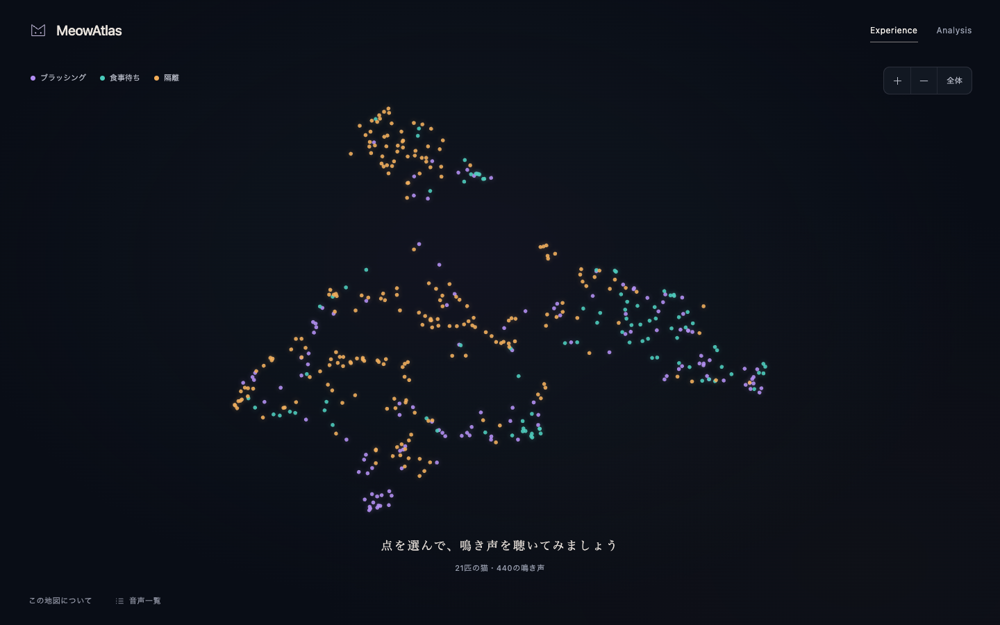
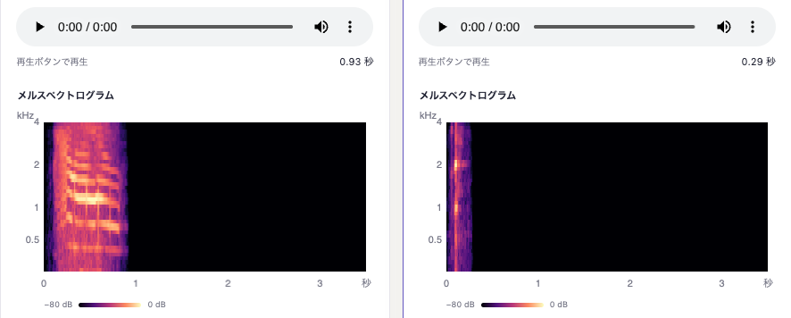

# MeowAtlas

An interactive listening atlas of **440 cat vocalizations from 21 cats**.
Explore a fixed sound map, listen to individual recordings, and compare their
time–frequency patterns in two connected views. The application interface is in Japanese.

[Open Experience](https://nha6ki.github.io/MeowAtlas/) ·
[Open Analysis](https://nha6ki.github.io/MeowAtlas/analysis.html)



## Experience and Analysis

- **Experience** opens with the map, a short invitation, and a color legend.
  Selecting a point plays its recording and reveals the cat profile and audio controls.
  Visitors can zoom, pan, and browse the recording list.
- **Analysis** lets visitors select recordings A and B, play them separately,
  and compare their spectrograms. Filters cover individual cats, breed, sex,
  neutering status, and recording context. Comparison suggestions can use
  distances in the original audio features or in the two-dimensional map.

Both views use the same saved coordinates and preserve the selected recording
when moving between pages. Filtering changes visibility without fitting a new map.



## Run locally

The website is static. No model server, API key, or JavaScript build step is required.

```sh
python3 -m http.server 8767 --bind 127.0.0.1 --directory site
```

Open <http://127.0.0.1:8767/> for Experience or
<http://127.0.0.1:8767/analysis.html> for Analysis.
All runtime assets are bundled; citation links lead to external websites.
Analysis preferences are stored locally in the browser. The application contains
no audio-upload or microphone-input feature.

## How the map was made

MeowAtlas uses all 440 recordings in **CatMeows v1.0.2**, released by researchers
at the University of Milan. The contexts are brushing, waiting for food, and
isolation in an unfamiliar environment.

The adopted pipeline trims 0.4 seconds from each end of each recording, applies
0.05-second linear fades, and computes 40-band log-Mel spectrograms. Each
spectrogram is standardized, padded at the end, and flattened into a feature
vector. Unsupervised UMAP produces the saved two-dimensional coordinates using
15 neighbors, `min_dist=0.1`, Euclidean distance, and seed 42.

Recording-context labels are not inputs to the embedding. No artificial
coordinate adjustment is applied. The website displays the saved result;
opening or publishing it does not rerun UMAP.

See [Methods](docs/METHODS.md) for the full settings and
[Analysis reproduction](analysis/README.md) for the input, code, and verification procedure.

## Interpretation

This is a listening and comparison demo. Map proximity is not a validated measure
of perceptual similarity, and point groups are not established categories of cat
emotion or intention. Recording length, timing, background sound, and individual
cats can affect the distances. Breed and recording environment are not isolated
experimental factors in this dataset.

The cat photographs are illustrative images of the same breed, not photographs
of the recorded cats. The visible cat IDs and profiles refer to the recordings.

## Repository contents

| Path | Contents |
| --- | --- |
| `site/` | Complete static website, recordings, spectrograms, and image credits |
| `analysis/` | Adopted parameters, frozen reference, metadata, and reproduction code |
| `docs/` | Methods, screenshots, validation, and publication instructions |
| `scripts/verify_release.py` | Asset, link, metadata, and release-integrity checks |
| `.github/workflows/` | Validation and manually triggered GitHub Pages deployment |

```sh
python3 scripts/verify_release.py
```

## Credits and reuse

CatMeows v1.0.2: Luca Andrea Ludovico, Stavros Ntalampiras, Giorgio Presti,
Simona Cannas, Monica Battini, and Silvana Mattiello.
[Dataset DOI](https://doi.org/10.5281/zenodo.4008297).

Ludovico et al. (2021). *CatMeows: A Publicly-Available Dataset of Cat Vocalizations*.
MultiMedia Modeling, LNCS 12573, pp. 230–243.
[Paper DOI](https://doi.org/10.1007/978-3-030-67835-7_20).

Original application code is licensed under [MIT](LICENSE).
**It does not cover the dataset or photographs.**
The version-specific Zenodo metadata identifies CatMeows as **CC BY-NC 4.0**;
photographs retain their individual Creative Commons licenses.
See [Third-party notices](THIRD_PARTY_NOTICES.md) for authors, changes, and license links.
